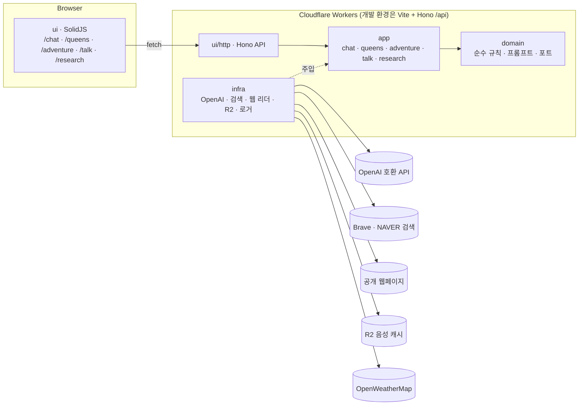

# ai-ps

『문제 해결을 위한 AI 에이전트 설계』의 장별 프로젝트를 SolidJS, Hono, Cloudflare Workers로 구현한 실습입니다. 메이저 버전 번호는 책의 장 번호를 따릅니다.


> 출처: [문제 해결을 위한 AI 에이전트 설계 (한빛미디어)](https://www.hanbit.co.kr/books/%EB%AC%B8%EC%A0%9C-%ED%95%B4%EA%B2%B0%EC%9D%84-%EC%9C%84%ED%95%9C-ai-%EC%97%90%EC%9D%B4%EC%A0%84%ED%8A%B8-%EC%84%A4%EA%B3%84?code=E8013136640)

## 기능

| 책의 장 | 라우트 | 기능 | 문서 | 운영 |
| --- | --- | --- | --- | --- |
| 3 | `/chat` | Plan and Execute·ReAct·Function Calling 채팅과 날씨 도구 | [공급자](docs/providers.md) | [채팅](https://ai-ps.qus0in.workers.dev/chat) |
| 4 | `/queens` | 코드가 정답을 만들고 LLM이 영역을 제안하는 Queens 퍼즐 생성·플레이 | [Queens](docs/queens.md) | [Queens](https://ai-ps.qus0in.workers.dev/queens) |
| 5 | `/adventure` | 상태 요약과 8비트 자산을 사용하는 텍스트 어드벤처 「잿빛 등대」 | [어드벤처](docs/adventure/) | [어드벤처](https://ai-ps.qus0in.workers.dev/adventure) |
| 6 | `/talk` | 음성 인식·Realtime 음성 합성·R2 캐시를 사용하는 일본어 회화. 기존 릴리스는 5.2.x | [회화](docs/talk/) | [회화](https://ai-ps.qus0in.workers.dev/talk) |
| 7 | `/research` | Brave·NAVER 검색과 웹 본문 읽기로 출처가 포함된 보고서 작성 | [리서치](docs/research/) | [리서치](https://ai-ps.qus0in.workers.dev/research) |

## 아키텍처



의존 방향은 `ui → app → domain`이고, `infra`는 `app`에 주입합니다(`tests/arch`가 검사).

## 실행

```bash
pnpm install
cp .env.example .env   # OPENAI_API_KEY 등 입력
pnpm dev               # http://localhost:5173
pnpm test && pnpm typecheck && pnpm build
```

| .env 이름 | 용도 | 설정하지 않은 경우 |
| --- | --- | --- |
| `OPENAI_API_KEY`·`OPENAI_MODEL` | 모델 호출 | 모델이 필요한 요청이 실패합니다. Queens는 알고리즘 경로를 사용할 수 있습니다. |
| `OPENAI_BASE_URL` | OpenAI 호환 공급자의 API 주소 | 기본 OpenAI 주소를 사용합니다. |
| `OWM_API_KEY` | 채팅 날씨 도구 | 날씨 도구가 설정 오류를 반환합니다. |
| `BRAVE-SEARCH-API-KEY` | 리서치의 Brave 검색(폴백) | NAVER가 설정돼 있으면 한국어 질의는 NAVER를 먼저 쓰고 결과가 2건 미만일 때만 Brave를 추가 호출합니다. 한글이 없는 질의는 Brave만 사용합니다. |
| `X-NCP-APIGW-API-KEY-ID`·`X-NCP-APIGW-API-KEY` | 리서치의 NAVER 웹문서·뉴스·블로그 검색(일일 25,000회, 1차) | NAVER가 없으면 Brave만 사용합니다. |

리서치에는 두 검색 공급자 중 하나가 필요합니다. 배포 스크립트가 로컬 검색 키 이름을 Workers의 `BRAVE_SEARCH_API_KEY`·`NCP_API_KEY_ID`·`NCP_API_KEY`로 매핑합니다.

## 배포

Cloudflare Workers 배포는 총괄만 수행합니다. `pnpm run deploy`가 빌드·secret 동기화·배포·스모크를 이어 합니다. 공급자 교체는 [docs/providers.md](docs/providers.md)를, 자세한 절차는 [운영 절차](docs/harness/operations.md)를 참고하세요.

## 운영 방식

Herdr에서 총괄 에이전트가 레이어와 파일 단위로 작업을 나누고, 구현자와 다른 모델 계열의 에이전트가 리뷰합니다. [에이전트 구성](docs/harness/agents.md) · [운영 절차](docs/harness/operations.md) · [세션별 회고](docs/retro/)

## 라이선스

[MIT](LICENSE)
