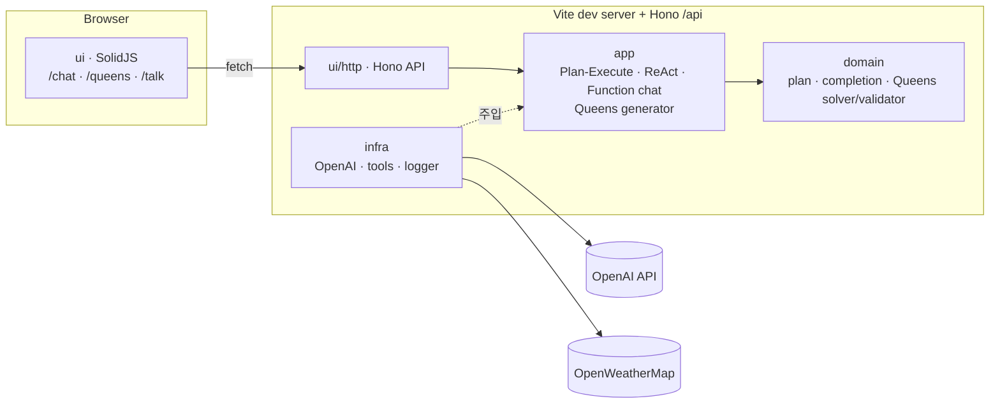

# ai-ps

문제 해결형 AI 에이전트 실습 — Plan-Execute·ReAct·Function calling 채팅 에이전트, LLM 기반 Queens 퍼즐 생성기, 일본어 회화 연습.


> 출처: [문제 해결을 위한 AI 에이전트 설계 (한빛미디어)](https://www.hanbit.co.kr/books/%EB%AC%B8%EC%A0%9C-%ED%95%B4%EA%B2%B0%EC%9D%84-%EC%9C%84%ED%95%9C-ai-%EC%97%90%EC%9D%B4%EC%A0%84%ED%8A%B8-%EC%84%A4%EA%B3%84?code=E8013136640)

## 아키텍처



의존 방향은 `ui → app → domain`이고, `infra`는 `app`에 주입합니다(`tests/arch`가 검사).

## 실행

```bash
pnpm install
cp .env.example .env   # OPENAI_API_KEY 등 입력
pnpm dev               # http://localhost:5173
pnpm test && pnpm typecheck && pnpm build
```

## 배포

Cloudflare Workers 배포는 총괄만 수행합니다. `pnpm run deploy`가 빌드·secret 동기화·배포·스모크를 이어 합니다. 공급자 교체는 [docs/providers.md](docs/providers.md)를, 자세한 절차는 [운영 절차](docs/harness/operations.md)를 참고하세요.

## 라이선스

[MIT](LICENSE)
